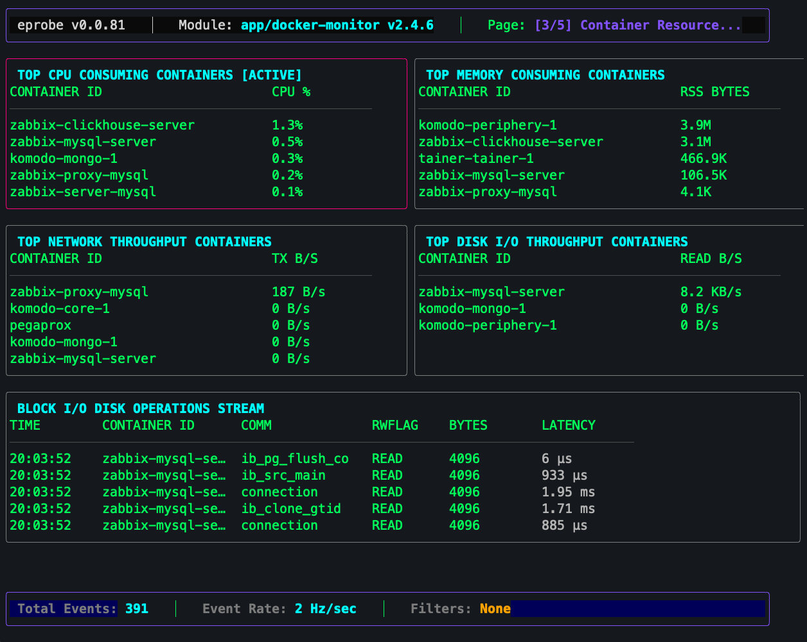

# eprobe: Tactical Ephemeral eBPF Incident Response Toolkit

<p align="center">
  <a href="https://eprobe.io/"></a>
  <a href="https://github.com/dimitribellini/eprobe-cli/releases/latest"></a>
  
  
  <a href="LICENSE"></a>
</p>

<p align="center">
  <b>The modern, zero-dependency eBPF replacement for <code>top</code>, <code>strace</code>, and <code>tcpdump</code>.</b><br />
  Built for <b>Site Reliability Engineers (SREs), L3 Escalation Engineers, and Platform DevOps</b> to triage live production incidents with <b>&lt;1% CPU overhead</b> and <b>zero background daemons left behind</b>.
</p>

<p align="center">
  <a href="https://eprobe.io/"><b>🌐 Official Website: eprobe.io</b></a> &nbsp;•&nbsp;
  <a href="https://github.com/dimitribellini/eprobe-cli/releases"><b>📦 GitHub Releases</b></a> &nbsp;•&nbsp;
  <a href="#-quick-start"><b>⚡ Quick Start</b></a> &nbsp;•&nbsp;
  <a href="#-tactical-incident-recipes"><b>🚨 Incident Recipes</b></a> &nbsp;•&nbsp;
  <a href="#-tui-navigation--shortcuts"><b>⌨️ Keybindings</b></a> &nbsp;•&nbsp;
  <a href="#-diagnostic-modules-catalog"><b>📁 Module Catalog</b></a>
</p>

---

<p align="center">
  
</p>

<p align="center">
  <em>Live interactive Bubbletea TUI displaying real-time container CPU %, memory RSS, network throughput, disk I/O, and block I/O stream with runtime container name resolution.</em>
</p>

---

## ⚡ Quick Start

### 1. Download & Install (Single Static Binary, &lt;25MB)

Choose your preferred installation method:

```bash
# ⚡ Method A: Instant Shell Installer (Recommended)
curl -sSL https://get.eprobe.io | sh

# ⚡ Method B: Direct Binary Download (GitHub Releases)
curl -sSL https://github.com/dimitribellini/eprobe-cli/releases/latest/download/eprobe-linux-amd64 -o eprobe
chmod +x eprobe
sudo mv eprobe /usr/local/bin/

# Verify installation
eprobe version
```

> **Fast 1-Liner (Local execution without PATH install)**:
> ```bash
> curl -sSL https://github.com/dimitribellini/eprobe-cli/releases/latest/download/eprobe-linux-amd64 -o eprobe && chmod +x eprobe
> sudo ./eprobe run app/docker-monitor
> ```
> 
> *Need a pinned version? Use the tagged release syntax:*
> `curl -sSL https://github.com/dimitribellini/eprobe-cli/releases/download/v0.0.85/eprobe-v0.0.85-linux-amd64 -o eprobe`

### 2. Triage Your First Incident (Instant Run)

Launch interactive container diagnostics with live resource leaderboards:

```bash
sudo eprobe run app/docker-monitor
```

> [!NOTE]
> `eprobe` automatically downloads and verifies cryptographically signed eBPF bytecode packages on demand from the registry (`https://api.eprobe.io`) and caches them locally. No compiler toolchain (`clang`, `llvm`) or kernel headers are required on the target machine.

---

## 🎯 Why eprobe? The Three Tactical Pillars

When standard APM platforms (Datadog, Grafana) alert that a system is degraded, they lack the kernel-level resolution to explain **why**. Legacy diagnostic tools like `strace` attach via `ptrace` and impose a catastrophic 100x performance penalty that risks freezing production databases. `eprobe` bridges this critical gap using read-only CO-RE eBPF:

| Pillar | How eprobe Solves It |
| :--- | :--- |
| ⚡ **Ephemeral & Zero-Instrumentation** | Single statically compiled binary (&lt;25MB). Injects read-only eBPF bytecode on demand; leaves **zero background daemons or sidecars** on the host. Clean detach with `Ctrl+C` or `q` terminates probes instantly. |
| 🔬 **High-Resolution Kernel Correlation** | Direct in-kernel correlation of off-CPU scheduler stalls, futex lockups, D-state disk sleep, cgroup CPU throttling, and network sockets to PIDs/TIDs with **&lt;1% CPU overhead**. |
| 🛡️ **Air-Gapped, BYO-LLM Root Cause Analysis** | Zero cloud egress required. Generates sanitized client-side `.zip` incident archives containing `00_PROMPT_COPY_PASTE.md` and statistical health profiles (`01_EXECUTIVE_SUMMARY.md`) for private Claude, ChatGPT, or local Ollama instances with **zero data leaks**. |

---

## 🚨 Tactical Incident Recipes

Run tactical diagnostics during live incidents with zero setup:

### ⏱️ Kernel Off-CPU Stalls & Storage Mutex Contention (`perf/stall-tracer`)
Diagnose unexplained thread freezes, D-state disk sleep, and futex rwlock contention:
```bash
# Launch interactive TUI with default 20ms stall threshold
sudo eprobe run perf/stall-tracer

# Isolate stalls for a specific process PID during an active incident
sudo eprobe run perf/stall-tracer --pid 4092

# Filter exclusively for D-state (uninterruptible disk/storage sleep)
sudo eprobe run perf/stall-tracer --stall-type 1
```

### 🐳 Container Crashes & CPU CFS Throttling (`app/docker-monitor`)
Triage container OOM kills, noisy neighbors, and cgroup bandwidth throttling:
```bash
# Launch container diagnostics with human-readable container names
sudo eprobe run app/docker-monitor

# Isolate diagnostics to a specific container PID
sudo eprobe run app/docker-monitor --pid 14208
```

### 🔐 Universal Plaintext TLS Inspection (`app/universal-tls-sniffer`)
Intercept decrypted HTTPS/HTTP2 traffic via OpenSSL uprobes without installing proxy certificates:
```bash
# Launch TLS decryption with automatic credential redaction (Bearer tokens masked by default)
sudo eprobe run app/universal-tls-sniffer

# Filter for a specific API domain and capture only HTTP errors (4xx & 5xx)
sudo eprobe run app/universal-tls-sniffer --host api.stripe.com --errors-only
```

### 🌐 HTTP Ingress & Microsecond TTFB Cascades (`app/http-tracer`)
Analyze request latency, slow response times, and 5xx cascades:
```bash
# Trace HTTP traffic on port 8080 with 20ms slow request alert
sudo eprobe run app/http-tracer -port 8080 -slow-ms 20
```

### 🛡️ Process Execution & Privilege Escalation (`sec/exec-audit`)
Audit process executions, 256-byte arguments, and parent-child lineages across `sudo`:
```bash
# Launch real-time process execution forensics
sudo eprobe run sec/exec-audit

# Stream structured NDJSON to SIEM or file
sudo eprobe run sec/exec-audit -output json
```

---

## ⌨️ TUI Navigation & Shortcuts

When running in interactive TUI mode (`eprobe run <module>`), navigate smoothly across multi-page diagnostic dashboards:

| Shortcut | Action | Description |
| :---: | :--- | :--- |
| **`1` – `9`** | **Direct Chapter Jump** | Instantly jumps to the corresponding diagnostic view page |
| **`[` / `]`** | **Previous / Next Page** | Cycles sequentially through multi-page diagnostic views |
| **`Tab`** | **Cycle Active Pane** | Moves focus between layout panes (highlighted with colored border) |
| **`m`** | **Maximize / Restore** | Expands the focused pane to 100% full screen (press again to restore) |
| **`Enter`** | **Inspect Event** | Opens deep inspection modal (shows full SQL queries, HTTP payloads, headers) |
| **`/`** | **Dynamic Filter** | Activates real-time substring filtering on active stream or leaderboard |
| **`Space` / `p`** | **Pause / Resume** | Freezes live stream to inspect high-frequency events without terminal jitter |
| **`↑` / `↓`** | **Navigate Rows** | Moves selection cursor through table events or trace tree nodes |
| **`←` / `→`** | **Fold / Unfold Tree** | Collapses or expands the selected trace tree branch |
| **`e`** | **Toggle All Branches** | Expands or collapses all branches across the entire trace tree |
| **`?`** | **Help & Brief Modal** | Displays module metadata, mission statement, and keybindings |
| **`Esc`** | **Dismiss / Back** | Closes active inspect modal, search bar, or restores maximized pane |
| **`q` / `Ctrl+C`**| **Graceful Detach** | Safely unlinks eBPF probes from the kernel and cleans up BPF maps |

---

## ☁️ Live Web Collaboration & SaaS Streaming

Need to triage collaboratively with your distributed incident response team? Stream live telemetry to the browser-based Web Inspector at [eprobe.io](https://eprobe.io):

```bash
# Extract live kernel telemetry to collaborative Web Diagnostic View
sudo eprobe run app/docker-monitor --stream-token 0486cf95-eb6a-4cf6-aa4e-d6ec1ffeaf03
```

Renders a live terminal monitor with connection health and bandwidth metrics:

```text
┌─ eprobe Incident Telemetry Ingestion ──────────────────────────────────┐
│  Connection:       ● CONNECTED (Port 443 / TLS)                        │
│  Target Broker:    https://stream.eprobe.io                            │
│  Stream Token:     0486cf95-eb6a-4cf6-aa4e-d6ec1ffeaf03               │
│  Module:           app/docker-monitor (2.4.6)                          │
│  Handshake:        ✔ Manifest Synchronized                             │
│  Session Time:     00:03:42                                            │
│                                                                        │
│  ── Data Transfer & Network Statistics ──────────────────────────────  │
│  Events Streamed:  14,820 events  (Rate: 260 evt/s)                    │
│  Micro-Batches:    296 batches (50ms interval)                         │
│  Data Transferred: 138.4 KB  (Raw: 1.12 MB, -87.6% Gzip savings)       │
│                                                                        │
│  👉 Live Diagnostic View:                                              │
│  https://eprobe.io/dashboard/app-docker-monitor/0486cf95-eb6a-4cf6...  │
│                                                                        │
│  Press [Ctrl+C] or [q] to stop extraction and clean detach probe.      │
└────────────────────────────────────────────────────────────────────────┘
```

---

## 📁 Diagnostic Modules Catalog

Modules are organized into focused operational domains in the Remote Registry:

| Domain | Module | Description | Fast Command |
| :--- | :--- | :--- | :--- |
| **`perf/`** | `perf/stall-tracer` | Off-CPU stalls, D-state storage sleep, scheduler preemption & futex contention | `sudo eprobe run perf/stall-tracer` |
| **`app/`** | `app/docker-monitor` | Container resource consumption, CPU throttling, OOMs & block I/O stream | `sudo eprobe run app/docker-monitor` |
| **`app/`** | `app/universal-tls-sniffer` | Plaintext HTTPS/HTTP2 inspection via OpenSSL uprobes with auto-sanitization | `sudo eprobe run app/universal-tls-sniffer` |
| **`app/`** | `app/http-tracer` | HTTP status codes, microsecond TTFB, W3C distributed trace trees & 5xx cascades | `sudo eprobe run app/http-tracer` |
| **`app/`** | `app/mysql-monitor` | Query execution latency, slow query leaderboards & table-level locks | `sudo eprobe run app/mysql-monitor` |
| **`app/`** | `app/zabbix-monitor` | Zabbix server internal queue delays, poller sync & database bottlenecks | `sudo eprobe run app/zabbix-monitor` |
| **`sec/`** | `sec/exec-audit` | Process execution forensics, 256-byte args, parent-child lineages & login UIDs | `sudo eprobe run sec/exec-audit` |
| **`log/`** | `log/stderr-capture` | Kernel-level capture of stderr writes (`fd == 2`) and unhandled crashes | `sudo eprobe run log/stderr-capture` |

> [!TIP]
> Run `eprobe search` to discover all available modules from the registry, or `eprobe help <module>` for dedicated module documentation, attach points, and flags.

---

## 🛠️ CLI Reference & Commands

```bash
eprobe run <module> [flags]      # Execute diagnostic module (auto-pulls if missing)
eprobe pull <module>             # Download and verify module from registry
eprobe list                      # List locally cached modules
eprobe search                    # Search remote registry for available modules
eprobe describe <module>         # Display configuration and layout of a cached module
eprobe update <module>           # Sync local module cache with latest registry release
eprobe remove <module>           # Delete cached module from disk (alias: rm)
eprobe help [module]             # Show general CLI help or dedicated per-module help
eprobe version                   # Display CLI version
```

### Global Flags

| Flag | Description | Default |
| :--- | :--- | :--- |
| `-output <format>` | Output mode: `tui` (interactive), `text`, `json`, `ndjson`, or `stream` | `tui` |
| `--pid <PID>` | Filter events by process PID | `0` (all) |
| `-port <port>` | Filter events by TCP/UDP port number | `0` (all) |
| `--comm <name>` | Filter events by process command name | (none) |
| `--host <domain>` | Filter HTTP/TLS events by host header or SNI | (none) |
| `--errors-only` | Filter HTTP events exclusively to 4xx and 5xx errors | `false` |
| `--slow-ms <ms>` | Highlight/alert slow operations exceeding threshold in milliseconds | `0` |
| `--no-sanitize` | Disable default credential masking (reveals Authorization Bearer tokens) | `false` |
| `-stream-token <UUID>` | SaaS portal stream token for real-time collaboration | (none) |
| `-stream-url <URL>` | Streaming broker URL | `https://stream.eprobe.io` |
| `-registry <URL>` | Remote module registry API | `https://api.eprobe.io` |

---

<details>
<summary><b>🏗️ Architecture & Internal Data Flow (Click to expand)</b></summary>

### System Architecture

```
 +--------------------------------------------------------------------------+
 |                              LOCAL CLIENT                                |
 |                                                                          |
 |  +---------------+      (1) CLI Command       +-----------------------+  |
 |  |  Operator CLI | -------------------------> |     Runtime Engine    |  |
 |  +---------------+                            +-----------------------+  |
 |                                                           |              |
 |  +---------------+      (4) Load Bytecode                 |              |
 |  | Linux Kernel  | <--------------------------------------+              |
 |  +---------------+                                        |              |
 |         |                                                 | (3) Mount    |
 |         | (5a) Emit Events          (5b) Hash Maps        |     & Listen |
 |         v                                v                v              |
 |  +---------------+             +---------------+                         |
 |  |  Ring Buffer  |             |  BPF Hash     |                         |
 |  +---------------+             |  Maps (Tick)  |                         |
 |         |                      +---------------+                         |
 |         |       (6) Process Telemetry   |        +-----------------------+|
 |         +----------------------------->|------->|  Telemetry Pipeline   ||
 |                                                  +-----------------------+|
 |                                                           |              |
 +-----------------------------------------------------------|--------------+
                                                             |
                 +-------------------------------------------+
                 | (2) Get Module                            | (7) WSS Ingestion (443)
                 v                                           v
   +---------------------------+               +---------------------------+
   |   REMOTE REGISTRY         |               |   WEB INSPECTOR           |
   |   (Signed Packages)       |               |   (Diagnostic Views & RCA)|
   +---------------------------+               +---------------------------+
```

### Module Package Schema (`manifest.yaml`)

Each dynamic diagnostic module is packaged into an `.epm` bundle containing the compiled CO-RE ELF bytecode (`program.o`), Ed25519 signature (`manifest.sig`), and a declarative `manifest.yaml`:

```yaml
name: perf/stall-tracer
version: 1.0.0
description: "High-resolution off-CPU scheduler stall diagnostics"
attach_points:
  - type: raw_tracepoint
    symbol: sched_switch
    section: raw_trace_sched_switch
maps:
  - name: stall_events
    type: ringbuf
    event_struct: stall_event_t
    event_schema:
      - { name: pid, type: uint32 }
      - { name: comm, type: string, length: 16 }
      - { name: container_id, type: string, length: 16, format: container_id }
      - { name: duration_us, type: uint64 }
tui_hints:
  pages:
    - name: "Scheduler Stalls Overview"
      panes:
        - name: stall_events_stream
          type: stream
          map_name: stall_events
          columns:
            - { field: time, width: 10 }
            - { field: pid, width: 8, bold: true, color: "#FFA500" }
            - { field: comm, width: 16 }
            - { field: duration_us, width: 12 }
```
</details>

<details>
<summary><b>🔨 Building from Source & Developer Setup (Click to expand)</b></summary>

### Prerequisites
* Linux OS with Kernel 5.8+ (CO-RE enabled)
* `/sys/kernel/btf/vmlinux` available on target host
* Go 1.21+ (only needed if compiling from source)

### Build Commands
```bash
# Clone the repository
git clone https://github.com/dimitribellini/eprobe-cli.git
cd eprobe-cli

# Run unit tests
go test -v ./...

# Compile standalone static binary
make build
```
</details>

---

## 🔒 Security & Graceful Clean Detach

- **Zero Host Mutation**: Probes attach in read-only mode via kernel tracepoints, kprobes, and uprobes.
- **Instant Clean Detach**: Pressing `Ctrl+C` or `q` traps `SIGINT`/`SIGTERM` to safely detach all probes from the kernel and purge allocated BPF ring buffers and hash maps, leaving zero residual background daemons.
- **Cryptographic Trust**: Every module manifest and bytecode bundle is verified via Ed25519 signatures before execution.
- **Default Credential Masking**: Authorization headers, Bearer tokens, and API keys are automatically sanitized (`**********`) during live inspection and streaming.

---

## 📄 License
Copyright (c) 2026 **eprobe team**. This project is licensed under the MIT License - see the [LICENSE](LICENSE) file for details.
